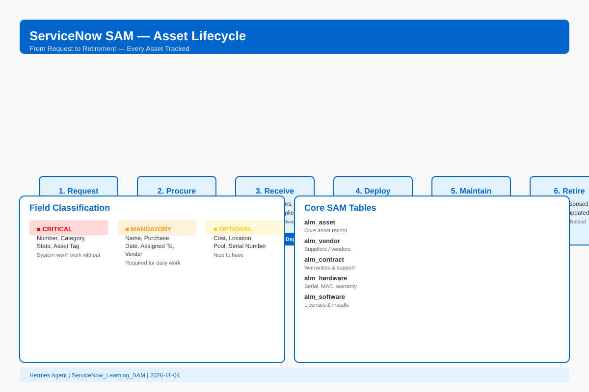
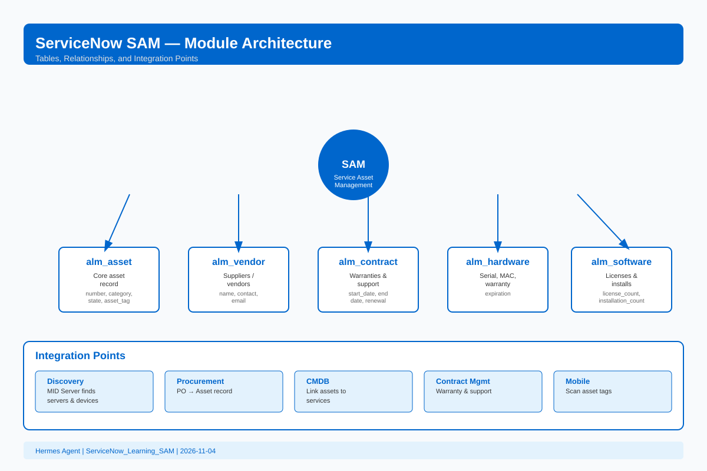
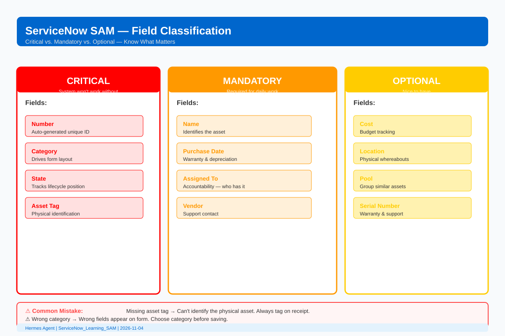

# Hermes — ServiceNow SAM Getting-Started Resources

**Author:** Hermes Agent  
**Date:** 2026-11-04  
**Branch:** main  
**Repo:** https://github.com/eltonaguiar/ServiceNow_Learning_SAM

---

## Purpose

This folder contains a curated list of resources for getting started with **ServiceNow SAM (Service Asset Management)** — the module that helps organizations track, manage, and optimize IT assets (hardware, software, licenses, contracts) throughout their full lifecycle.

These resources are organized from "I've never heard of SAM" to "I can configure and use SAM in ServiceNow."

---

## Quick Start Path

If you're brand new to ServiceNow SAM, follow this order:

| Step | Resource | What You'll Learn |
|------|----------|-------------------|
| 1 | [SAM ELI5 Basics](Hermes/sam-getting-started-resources.md#eli5-basics) | What SAM is, in plain English |
| 2 | [SAM Core Tables](Hermes/sam-getting-started-resources.md#core-tables) | Where asset data lives in the database |
| 3 | [SAM Module Framework](Hermes/sam-getting-started-resources.md#module-framework) | How SAM fits into ServiceNow |
| 4 | [SAM Field Cheat Sheet](Hermes/sam-getting-started-resources.md#field-cheat-sheet) | Which fields matter and why |
| 5 | [SAM Guided Setup](Hermes/sam-getting-started-resources.md#guided-setup) | How to turn SAM on and configure it |
| 6 | [SAM Asset Lifecycle Lab](Hermes/sam-getting-started-resources.md#hands-on-lab) | Build a working asset from request to retirement |
| 7 | [SAM Common Mistakes](Hermes/sam-getting-started-resources.md#common-mistakes) | What to avoid as a beginner |

---

## Table of Contents

- [What is SAM? (ELI5)](#eli5-basics)
- [Core SAM Tables](#core-tables)
- [SAM Module Framework](#module-framework)
- [SAM Field Cheat Sheet (Critical / Mandatory / Optional)](#field-cheat-sheet)
- [SAM Guided Setup & Prerequisites](#guided-setup)
- [SAM Integration Points](#integration-points)
- [SAM Common Beginner Mistakes](#common-mistakes)
- [SAM Quick Actions (Where to Click)](#quick-actions)
- [Next Steps & Recommended Order](#next-steps)

---

<a name="eli5-basics"></a>
## What is SAM? (ELI5)

ServiceNow SAM is like a giant inventory system for everything your company owns that's IT-related:

- **Laptops, servers, phones** — hardware assets
- **Software licenses, subscriptions** — software assets
- **Maintenance contracts, warranties** — contract assets
- **Where each asset is, who has it, when it was bought, when it expires**

Without SAM, companies lose track of what they own, pay for licenses they don't use, and get surprised when assets break or expire.

**The asset lifecycle:**



```
Request → Procure → Receive → Deploy → Maintain → Retire
```

---

<a name="core-tables"></a>
## Core SAM Tables

| Table | Purpose | Key Fields |
|-------|---------|------------|
| `alm_asset` | Core asset record | number, category, state, assigned_to, asset_tag |
| `alm_asset_category` | Asset categories | name, parent, active |
| `alm_asset_state` | Lifecycle states | name, sequence, default |
| `alm_vendor` | Vendors/suppliers | name, contact, email |
| `alm_hardware` | Hardware-specific fields | serial_number, mac_address, warranty_expiration |
| `alm_software` | Software-specific fields | license_count, installation_count |
| `alm_contract` | Maintenance/support contracts | start_date, end_date, renewal_date |
| `alm_asset_model` | Asset models | name, manufacturer, category |

---

<a name="module-framework"></a>
## SAM Module Framework

**Core relationships:**



```
Asset → Category (many-to-one)
Asset → Vendor (many-to-one)
Asset → Assigned To (many-to-one, User)
Asset → Model (many-to-one)
Contract → Vendor (many-to-one)
Software Installation → Asset (many-to-one)
Software Installation → License (many-to-one)
```

**Module prerequisites:**
- ITIL role for asset managers
- Admin role for configuration
- CMDB partially populated (for discovered assets)
- Procurement process defined
- Vendor records created

---

<a name="field-cheat-sheet"></a>
## SAM Field Cheat Sheet (Critical / Mandatory / Optional)



### Critical (System Won't Work Without)
- **Number** — Auto-generated, unique identifier
- **Category** — Drives form layout and available fields
- **State** — Tracks lifecycle position (In Stock, Assigned, In Repair, Retired)
- **Asset Tag** — Physical identification sticker number

### Mandatory (Required for Daily Work)
- **Name** — Identifies the asset
- **Purchase Date** — Warranty and depreciation calculations
- **Assigned To** — Accountability (who has the asset)
- **Vendor** — Support contact (who you bought from)

### Optional (Nice to Have)
- **Cost** — Budget tracking
- **Location** — Physical whereabouts
- **Pool** — Grouping similar assets
- **MAC Address** — Network identification
- **Serial Number** — Links to warranty and support

---

<a name="guided-setup"></a>
## SAM Guided Setup & Prerequisites

**Where to find Guided Setup:**
```
System Definition > Guided Setup > SAM
```

**Setup checklist:**
1. ✅ Define asset categories (Hardware > Computer > Laptop, etc.)
2. ✅ Create vendor records (Dell, Microsoft, etc.)
3. ✅ Create asset models (Dell XPS 13, Microsoft Office 365, etc.)
4. ✅ Set up lifecycle states (In Stock, Assigned, In Repair, Retired)
5. ✅ Create asset tags (physical stickers or virtual tags)
6. ✅ Configure procurement flow (PO → Asset record)
7. ✅ Set up contract tracking (warranty, support, lease expiration)
8. ✅ Assign roles (ITIL, asset manager, procurement)

---

<a name="integration-points"></a>
## SAM Integration Points

| Integration | Purpose |
|-------------|---------|
| Discovery (MID Server) | Automatically find servers, computers, network devices |
| Procurement | Convert purchase orders to asset records |
| CMDB | Link assets to services and business impacts |
| Contract Management | Track warranty and support expirations |
| Mobile | Scan asset tags with mobile devices |
| Software Asset Management (SAM) Pro | Track software licenses and installations |

---

<a name="common-mistakes"></a>
## SAM Common Beginner Mistakes

| Mistake | What Happens | How to Avoid | How to Fix |
|---------|-------------|-------------|------------|
| Buying assets without creating asset records first | Procurement and asset teams don't sync | Create asset record before or during purchase | Link PO to existing asset record |
| Not tracking software licenses | Licenses are invisible until you audit | Run regular license reconciliation | Reconcile installations vs. entitlements |
| Assets "disappear" after employee leaves | No offboarding process to recover assets | Add asset recovery to HR offboarding workflow | Create return task in offboarding |
| Keeping expired contracts | No one tracks renewal dates | Set up contract expiration alerts | Renew or retire contract |
| Missing asset tag | Can't physically identify the asset | Always tag assets on receipt | Add tag to existing record |
| Wrong category | Wrong fields show on form | Pick correct category before saving | Change category (may lose some data) |

---

<a name="quick-actions"></a>
## SAM Quick Actions (Where to Click)

| Action | Navigation Path |
|--------|-----------------|
| View all assets | `Asset Management > Assets > All` |
| Create new asset | `Asset Management > Assets > All > New` |
| Find an asset | Search by asset tag, serial number, or name |
| Change asset state | Open asset > State dropdown > Update |
| Reassign asset | Open asset > Assigned To field > Update |
| Retire asset | Open asset > State = Retired > Add reason |
| View vendors | `Asset Management > Vendors > All` |
| View contracts | `Asset Management > Contracts > All` |
| Guided Setup | `System Definition > Guided Setup > SAM` |

---

<a name="next-steps"></a>
## Next Steps & Recommended Order

1. **Read** `opencode/guides/sam-eli5-basics.md` — if you're brand new to SAM
2. **Read** `opencode/guides/sam-guided-setup.md` — to understand setup flow
3. **Bookmark** `opencode/resources/sam-field-cheatsheet.md` — daily field reference
4. **Complete** `opencode/labs/sam-asset-lifecycle.md` — hands-on practice
5. **Use** `opencode/scripts/sam_concept_summarizer.py` — break down any SAM concept
6. **Diagram** `opencode/templates/sam-architecture.mmd` — visualize SAM architecture

---

## Related Resources in This Repo

| Folder | Contents |
|--------|----------|
| `opencode/guides/` | ELI5 basics, guided setup, concept summaries |
| `opencode/resources/` | Field cheat sheet, module framework, mandatory vs critical |
| `opencode/labs/` | Asset lifecycle hands-on lab |
| `opencode/scripts/` | SAM concept summarizer script |
| `opencode/templates/` | SAM architecture diagram template |
| `Hermes/` | Hermes Agent resources (this folder) |

## Infographics (Visual References)

Click an image to view it full-size:

| Infographic | Preview | Description |
|-------------|---------|-------------|
| SAM Asset Lifecycle |  | Request → Procure → Receive → Deploy → Maintain → Retire |
| SAM Module Architecture |  | Core tables, relationships, integration points |
| SAM Field Classification |  | Critical vs. Mandatory vs. Optional fields |

All infographics are SVG — open directly in any browser or import into documentation.
