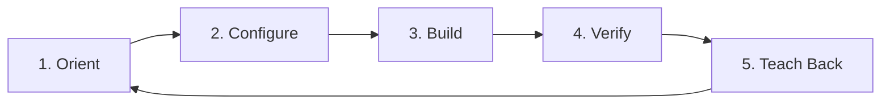

# KiloCodev2 — ServiceNow SAM Learning Materials (Infographics & Visual Guide)

**Agent:** Kilo  
**Date:** 2026-11-04  
**Repository:** https://github.com/eltonaguiar/ServiceNow_Learning_SAM  
**Branch:** kilocodev2  

---

## Visual Infographics & Diagrams

This guide is heavily focused on **visual learning** with infographics, diagrams, and flowcharts to help you master ServiceNow Software Asset Management (SAM) rapidly.

### Core Architecture & Relationships

<p align="center">
  
</p>

*Shows how SAM modules connect: Software Asset Management, Hardware Asset Management, Software Models, Entitlements, Reconciliation, and more.*

<p align="center">
  
</p>

*End-to-end SAM architecture showing data sources, normalization, reconciliation, and compliance reporting.*

### Learning & Compliance Workflows

<p align="center">
  
</p>

*License compliance workflow from discovery through reconciliation to remediation.*

<p align="center">
  
</p>

*Our proven 5-step rapid learning methodology applied to SAM.*

---

## Infographic Quick Reference

| Infographic | Purpose | Use Case |
|-------------|---------|----------|
| **SAM Module Relationships** | Visual map of all SAM components and how they connect | Understand the big picture before diving into modules |
| **SAM Architecture** | End-to-end data flow from discovery to compliance | Learn how data flows through the SAM ecosystem |
| **License Compliance Flow** | Step-by-step compliance process with decision points | Master reconciliation and remediation workflows |
| **Learning Loop** | 5-step methodology with time targets | Follow a repeatable learning approach for any SAM topic |

---

## Purpose

This directory contains **image-rich learning materials** for **ServiceNow SAM (Software Asset Management)** designed for visual learners. Materials cover SAM concepts, modules, workflows, integrations, Success Packs, and hands-on labs with clear diagrams.

All materials follow the proven 5-step rapid learning loop optimized for SAM.

---

## Directory Structure

```
KiloCode/
├── README.md                              # This file (Infographics-focused)
├── diagrams/                              # All infographics and diagrams
│   ├── sam-module-relationships.svg       # Module relationships
│   ├── sam-architecture.mmd               # Architecture diagram
│   ├── sam-license-compliance.mmd         # Compliance flow
│   └── learning-loop.mmd                  # Learning methodology
├── methodology/
│   └── rapid-learning-methodology.md      # Core 5-step learning loop
├── modules/
│   └── servicenow-sam-module-framework.md # SAM module learning framework
├── concepts/
│   └── servicenow-sam-concepts-eli5.md    # ELI5 SAM glossary with visuals
├── success-packs/
│   └── sam-success-pack-prerequisites.md  # SAM Success Pack guide
├── navigation/
│   └── sam-breadcrumbs-cheatsheet.md      # Visual navigation guide
├── common-mistakes/
│   └── sam-mistakes-to-avoid.md          # Pitfalls with visual cues
├── fields/
│   └── sam-mandatory-vs-critical-fields.md # Field importance matrix
├── out-of-box/
│   └── sam-out-of-box-workflows-integrations.md # OOB reference
├── labs/
│   ├── rest-message-integration/          # REST Message lab with diagrams
│   └── remote-table/                      # Remote Table lab with diagrams
├── scripts/
│   ├── rapid-learning-checklist.md         # Visual checklist
│   ├── lab-setup-template.md              # Lab template
│   └── concept-summary-template.md        # Summary template
└── meta/
    ├── AGENT.md                          # Agent info
    └── CHANGELOG.md                      # Changelog
```

---

## Learning Path (Visual Journey)



**Recommended Flow:**
1. **Start Here:** Review all infographics above to get the big picture
2. **Learn Concepts:** Read `concepts/servicenow-sam-concepts-eli5.md` with visual references
3. **Pick a Module:** Use `modules/servicenow-sam-module-framework.md` to plan your learning
4. **Do Labs:** Practice with REST Message and Remote Table labs
5. **Validate:** Use checklists and test against real scenarios

---

## Key SAM Topics Covered

| Topic | Coverage | Visual Aid |
|-------|----------|------------|
| **SAM Fundamentals** | Software models, entitlements, rights, installations, reconciliations | Module Relationships diagram |
| **Hardware Asset Management** | Asset lifecycle, procurement, contracts, disposal | Architecture diagram |
| **License Compliance** | True-up, compliance calculations, remediation | Compliance Flow diagram |
| **Discovery & Normalization** | Software discovery, normalization rules, publishers | Architecture diagram |
| **Workflows & Approvals** | OOB workflows, playbooks, approval routing | Compliance Flow diagram |
| **Integrations** | REST Messages, Remote Tables, MID Server | Architecture diagram |
| **Reporting & Dashboards** | Compliance dashboards, KPIs, metrics | All diagrams |

---

## Quick Start Guide

### For Complete Beginners
1. Look at **SAM Module Relationships** infographic first
2. Read **SAM Concepts ELI5** 
3. Follow the **Learning Loop** infographic for your first topic
4. Do a simple lab to reinforce

### For Intermediate Learners
1. Focus on **License Compliance Flow** infographic
2. Study **SAM Architecture** to understand data flow
3. Practice with Success Pack prerequisites
4. Build custom integrations

### For Advanced Learners
1. Master all diagrams and trace end-to-end flows
2. Create custom labs combining multiple SAM components
3. Optimize reconciliation rules and reports
4. Build automated remediation workflows

---

## Tools & Resources

- **Diagrams**: All visuals in `diagrams/` folder (SVG and Mermaid)
- **Checklists**: Quick reference in `scripts/`
- **Labs**: Hands-on practice in `labs/`
- **Breadcrumbs**: Navigation shortcuts in `navigation/`

---

## Pro Tips for Visual Learners

- **Print or pin** the infographics for quick reference
- **Trace the flows** with your finger/eyes to understand connections
- **Draw your own** - recreate diagrams from memory to test understanding
- **Teach with visuals** - explain using the diagrams to reinforce learning
- **Color code** - mentally group related components

---

*Generated by Kilo on 2026-11-04 | Branch: kilocodev2 | Part of ServiceNow_Learning_SAM repository*

**Remember:** *A picture is worth a thousand ServiceNow forms. Learn visually, practice hands-on, teach back.*
