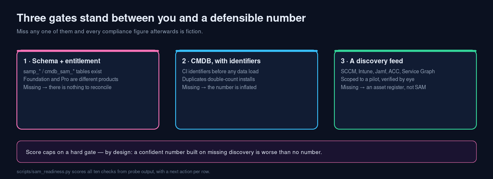
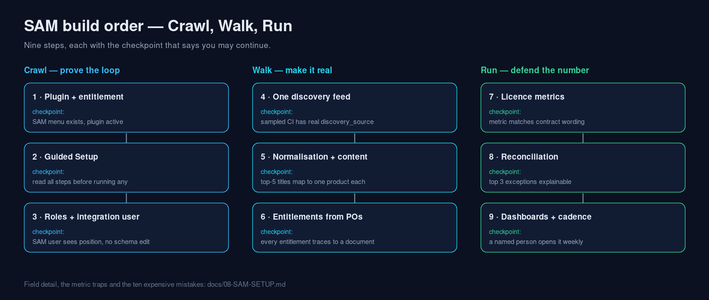

# ServiceNow Learning — SAM track

> **Agent:** buffy (mimo-v2.6-flash) · **Branch:** main · **Updated:** 2026-11-04

**Website:** <https://eltonaguiar.github.io/ServiceNow_Learning_SAM/>
**Main learning kit:** <https://github.com/eltonaguiar/ServiceNow_Learning>

The applied half of the ServiceNow learning kit: Software Asset Management, taken from
prerequisites to a licence position you can defend in an audit — instead of "what is SAM".

Everything reusable lives in the main repository on purpose. This repo holds the SAM track's
own entry point, so tools are never forked into two copies that drift.





Both diagrams are generated by `scripts/make_infographic.py` in the main repo — SVG for
diffing, PNG for slides.

## Courses, in order (SAM track)

Official Now Learning / ServiceNow University, sequenced so the SAM-specific material has
somewhere to land. Full rationale in the main repo:
[`docs/10-course-path.md`](https://github.com/eltonaguiar/ServiceNow_Learning/blob/main/docs/10-course-path.md).

| # | Course (search on Now Learning) | Take it when | Why this order |
|---|---|---|---|
| 1 | **ServiceNow Fundamentals** (free) | first | You cannot learn SAM on top of an unknown platform |
| 2 | **ServiceNow Administration Fundamentals** | next | Users, groups, imports — the SAM load path is an import |
| 3 | **Certified System Administrator (CSA)** | before any CIS | Gates every specialisation |
| 4 | **IT Asset Management / SAM fundamentals** (search "ITAM Fundamentals" and "Software Asset Management") | before touching the plugin | Licence metrics and reconciliation are concepts first |
| 5 | **CIS-ITAM** | when SAM is your job | The exam forces the whole lifecycle, not just licences |
| 6 | **Now Create: SAM Success Pack** (not a course) | before implementation | Prerequisites and acceptance criteria you will be measured on |

### Video material already in this repo (no video files yet)

Swept every branch on 2026-11-04: **no `.mp4`/`.webm` and no video URLs exist.** What does
exist is the preparation — now merged into `main` and linked here:

| Agent | What it is | Link |
|---|---|---|
| KiloCode | SAM video path, 8 items, titles + provider + length, no URLs | [video-guide-getting-started.md](https://github.com/eltonaguiar/ServiceNow_Learning_SAM/blob/main/KiloCode/docs/video-guide-getting-started.md) |
| opencode | 25–30 minute recording script | [video guide](https://github.com/eltonaguiar/ServiceNow_Learning_SAM/blob/main/opencode/guides/courses/video-guide-getting-started.md) |
| opencode | Slide deck companion | [video-slides.md](https://github.com/eltonaguiar/ServiceNow_Learning_SAM/blob/main/opencode/guides/courses/video-slides.md) |

The recording you actually need — eight minutes, scene by scene, on your own instance — is in
the main repo: [docs/11-video-guide.md](https://github.com/eltonaguiar/ServiceNow_Learning/blob/main/docs/11-video-guide.md).

---

## Contents

- [Start in five minutes](#start-in-five-minutes)
- [Is your instance even ready?](#is-your-instance-even-ready)
- [The build order](#the-build-order)
- [Prerequisites that actually block you](#prerequisites-that-actually-block-you)
- [Fields that decide the answer](#fields-that-decide-the-answer)
- [Metrics that lie](#metrics-that-lie)
- [The lab](#the-lab)
- [Reusable tools (in the main repo)](#reusable-tools-in-the-main-repo)
- [Official sources](#official-sources)
- [What is verified, and what is not](#what-is-verified-and-what-is-not)

---

## Start in five minutes

1. Get a free instance: <https://developer.servicenow.com/dev.do>
2. Run the read-only probe from the main repo (`scripts/sn_probe.js`) in
   *System Definition > Scripts - Background*
3. Score the instance:
   ```bash
   python3 scripts/sam_readiness.py probe.json
   ```
4. If the score says **NOT READY**, the scorecard's right-hand column is your work queue.
5. If it says **READY**, go to the lab and build a real compliance number.

---

## Is your instance even ready?

SAM has three hard gates. Missing any of them means every number you produce afterwards is
fiction, no matter how tidy the configuration looks:

| Gate | Why it is hard | How the scorecard sees it |
|---|---|---|
| **SAM schema + entitlement** | No tables, no reconciliation. Foundation and Professional are different products | `samp_*` / `cmdb_sam_*` tables present |
| **CMDB populated, with identification rules** | Duplicate CIs double-count installs. Note: identification rules are a **CMDB/IRE** mechanism, not SAM configuration — see below | `cmdb_ci` row count |
| **A discovery / connector feed** | Hand-typed installs are an asset register, not SAM | Discovery / Service Graph plugin |

PDIs usually lack the SAM entitlement. The lab's Part 0-B teaches the same reasoning with
`alm_asset` + product models only, so the concept survives the missing plugin.

---

## Identification rules: CMDB, not SAM (the question everyone asks)

They are the most misattributed control in this track, so keep the layers apart:

| Mechanism | Answers | Configured in | Applies to |
|---|---|---|---|
| **CI identification rules** (IRE) | Is this CI new, or the one I already have? | CI Class Manager / CI Identifiers, per CI class | **CMDB** — all CIs, including every server and laptop. This is what **HAM** relies on |
| **Asset↔CI reconciliation** (HAM) | Which asset record is this CI? | HAM asset sync on **serial number** | Hardware assets ↔ CIs — separate from identification |
| **Normalisation / recognition** | Are these two software titles the same product? | SAM ~ content library / publisher packs | **SAM** — SAM's real "identification" problem |
| **Licence metric** | Per user, device or core? | Entitlement | **SAM** — commercial decision |
| **Licence reconciliation** | Rights vs installs → compliance | SAM reconciliation | **SAM** — the number you defend |

**So: HAM yes, SAM indirectly.**

- **HAM:** directly. One laptop seen by SCCM, Intune and a manual import must resolve to one
  CI (serial number is the usual anchor). Bad rules = three laptops, three assets, no trust.
- **SAM:** no identification rules exist for software products — you *normalise* instead. But
  every install record hangs off a CI, so duplicate CIs duplicate installs and inflate the gap.
  Fix computer-class identification **before** you reconcile, or you will spend a week
  explaining a shortage that is really a duplicate.

> Rule of thumb: deduplicating *a machine* → CMDB/IRE. Deduplicating *a software title* →
> normalisation in SAM. Deduplicating *a quantity of rights* → a licence metric, and that is a
> commercial decision.

---

## The build order

Do not reorder. Each step assumes the previous checkpoint.

| # | Step | Checkpoint |
|---|---|---|
| 1 | Install/confirm the SAM plugin | SAM menu exists; plugin active |
| 2 | Guided Setup (if shipped) | You have read every step before running any |
| 3 | Roles + a dedicated integration user | A SAM user sees the position, cannot edit schema |
| 4 | One discovery/connector feed, small scope | A sampled CI has a real `discovery_source` and installs |
| 5 | Normalisation + content library | Top-5 titles each map to exactly one product |
| 6 | Entitlements from contracts/POs | Every entitlement traces to a document |
| 7 | Licence metrics per publisher | Platform metric matches contract wording |
| 8 | Reconciliation | You can explain the top 3 exceptions in one sentence each |
| 9 | Dashboards + cadence | A named person opens it on a schedule |

Full detail, field matrix and the ten expensive mistakes:
[`docs/08-SAM-SETUP.md`](https://github.com/eltonaguiar/ServiceNow_Learning/blob/buffy-mimo-v2.6-flash-2026-11-04/docs/08-SAM-SETUP.md)

---

## Prerequisites that actually block you

- [ ] **Foundation data loaded**: company, locations (with time zones), departments, cost centres, users, groups — SAM's spend dimensions are these fields, and empty dimensions make the compliance report unreadable ([guide](https://github.com/eltonaguiar/ServiceNow_Learning/blob/main/docs/09-foundation-data.md))
- [ ] Entitlement **and** plugin (Foundation vs Professional decided)
- [ ] Roles: asset manager, SAM admin, and a non-human **integration user**
- [ ] One working discovery feed (SCCM / Intune / Jamf / Agent Client Collector / Service Graph)
- [ ] CMDB identification rules **before** any data load
- [ ] Content library / publisher packs reachable
- [ ] Licence metric decisions written down and signed by the commercial owner
- [ ] Contract and PO data (or a plan to get it)
- [ ] A named owner for the reconciliation output

If three or more are missing, the next hour belongs to prerequisites, not to forms.

---

## Fields that decide the answer

| Object | Critical | Useful | Fixes a wrong number? |
|---|---|---|---|
| Entitlement | product, quantity, **metric**, start/end, licence type | publisher, contract link, cost | metric |
| Software install | linked CI, normalised product | version/edition, last seen, discovery source | — |
| Asset | asset_tag, model, state, assigned_to | cost centre, PO, warranty | — |
| Contract | start/end, vendor | renewal owner | dates |

Three kinds of "required" exist in ServiceNow — dictionary-mandatory, UI-policy-mandatory and
data-policy-mandatory. Only the first survives an API or import. The probe prints the
dictionary view for your instance; details in
[`docs/04-fields.md`](https://github.com/eltonaguiar/ServiceNow_Learning/blob/buffy-mimo-v2.6-flash-2026-11-04/docs/04-fields.md).

---

## Metrics that lie

| Metric | Use it? | Caution |
|---|---|---|
| Licence position per publisher | Yes | Publish discovery coverage % beside it |
| Installs without a normalised product | **Yes — best first KPI** | It predicts every other number |
| Renewals ≤ 90 days | Yes | Cheapest trust-builder in SAM |
| "Unlicensed installs" alone | No | Fear, not information, without coverage |
| Raw install count as "usage" | **No** | Installed ≠ used |

---

## The lab

[`labs/LAB-03-SAM-BASELINE.md`](https://github.com/eltonaguiar/ServiceNow_Learning/blob/buffy-mimo-v2.6-flash-2026-11-04/labs/LAB-03-SAM-BASELINE.md)
— three titles, three licence metrics, one defensible number. Then break it by changing the
metric and watch the answer flip: that is the moment SAM becomes a business conversation
rather than data entry.

---

## Reusable tools (in the main repo)

| Tool | Purpose |
|---|---|
| `scripts/sn_probe.js` | Read-only instance facts: tables, mandatory fields, related lists, plugins, Guided Setup, SAM tables |
| `scripts/sam_readiness.py` | Ten-check SAM readiness score with next actions |
| `scripts/sn_sheet.py` | Probe JSON → study sheet with a gap list |
| `scripts/sn_learn.py` | Timeboxed briefs, plans and quizzes per module |

Clone: `git clone https://github.com/eltonaguiar/ServiceNow_Learning.git` (branch
`buffy-mimo-v2.6-flash-2026-11-04` until merged).

---

## Official sources

| Source | Used for |
|---|---|
| <https://www.servicenow.com/docs/search?q=software+asset+management> | SAM configuration, licence metrics, reconciliation |
| <https://learning.servicenow.com/lxp> | Now Create Success Pack for SAM/ITAM (search "Now Create"); CIS-ITAM courses |
| <https://developer.servicenow.com/dev.do> | PDI, API Explorer |
| <https://store.servicenow.com/store> | Which SAM content and connectors your entitlement includes |
| <https://support.servicenow.com/now> | Reconciliation and normalisation errors |
| <https://community.servicenow.com/> | Audit gotchas from practitioners (verify before trusting) |

**ToS guardrails:** read manually, summarise in your own words, cite the URL. No scraping, no
mirroring, no republishing ServiceNow content.

---

## What is verified, and what is not

- **Verified:** the repository structure, the tooling, the readiness scorecard against a
  fixture probe, and every official URL's reachability (2026-11-04).
- **Not verified:** behaviour in a licensed SAM instance. No SAM-entitled instance was
  available, so this track is documentation-grounded and marks release-dependent claims
  **verify** — the probe resolves them against your instance.

Issues and corrections: <https://github.com/eltonaguiar/ServiceNow_Learning_SAM/issues>
