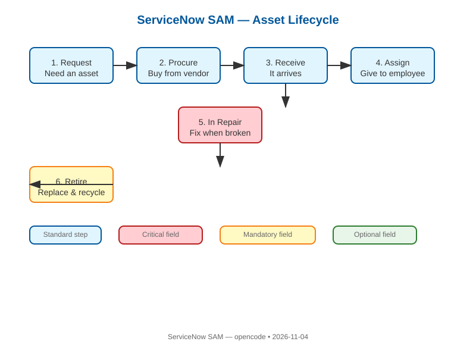
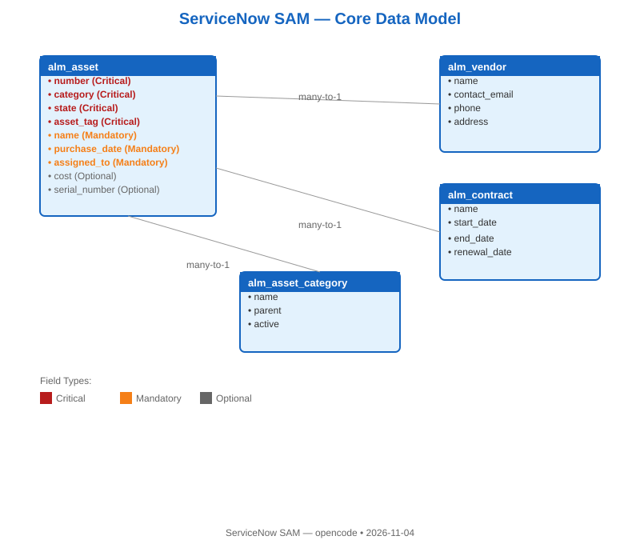
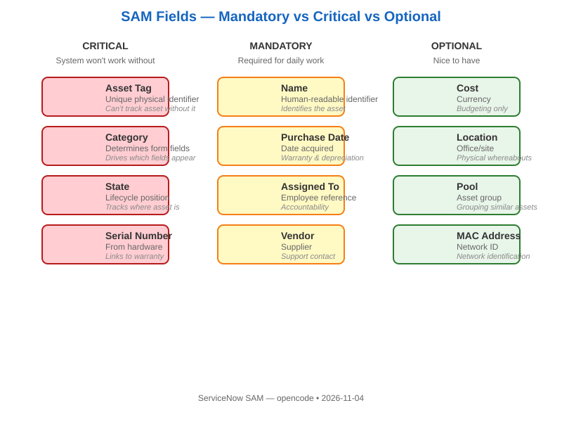
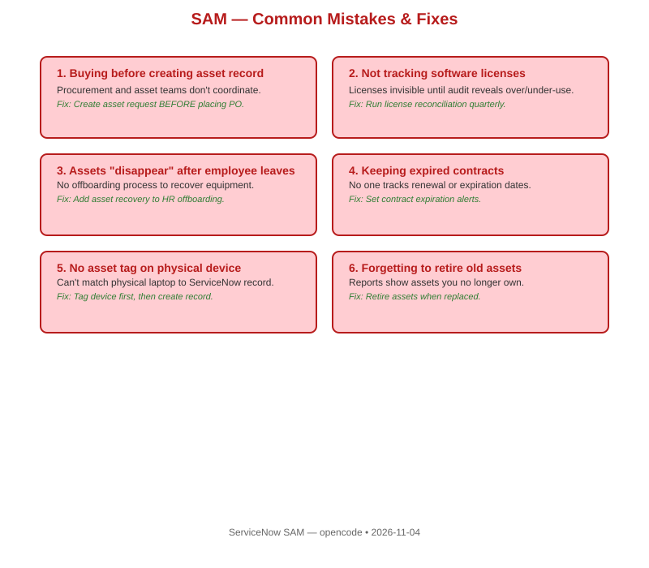
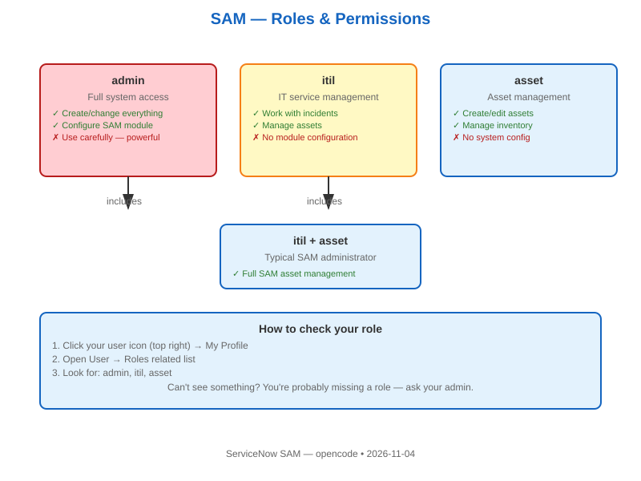

# ServiceNow SAM (Service Asset Management) Learning Resources

**Author:** opencode agent  
**Date:** 2026-11-04  
**Branch:** main  
**Repo:** https://github.com/eltonaguiar/ServiceNow_Learning_SAM

## Purpose

This folder contains beginner-friendly resources for learning **ServiceNow SAM (Service Asset Management)** — the module that helps organizations track, manage, and optimize their IT assets (hardware, software, licenses, contracts) throughout their entire lifecycle.

## What is SAM? (ELI5)

ServiceNow SAM is like a giant inventory system for everything your company owns that's IT-related:
- Laptops, servers, phones (hardware assets)
- Software licenses, subscriptions (software assets)
- Maintenance contracts, warranties (contract assets)
- Where each asset is, who has it, when it was bought, when it expires

Without SAM, companies lose track of what they own, pay for licenses they don't use, and get surprised when assets break or expire.

## Folder Structure

```
opencode/
  resources/    # Reference materials, cheat sheets, field mappings
  guides/       # Step-by-step beginner guides (ELI5)
  labs/         # Hands-on labs (build something real)
  scripts/      # Automation scripts for SAM learning
  templates/    # Infographic and diagram templates
  infographics/ # SVG images (asset lifecycle, data model, fields, mistakes, roles)
```

## Quick Start

1. **New to SAM?** Start with `guides/sam-eli5-basics.md`
2. **Want to set up SAM?** Follow `guides/sam-guided-setup.md`
3. **Want hands-on practice?** Complete `labs/sam-asset-lifecycle.md`
4. **Need a field reference?** Check `resources/sam-field-cheatsheet.md`
5. **Want to diagram SAM?** Use `templates/sam-architecture.mmd`
6. **Want visual diagrams?** View `infographics/` (SVG images below)

## Key SAM Concepts

| Concept | ELI5 Explanation |
|---------|-----------------|
| Asset | Anything IT-related your company owns (laptop, software license, server) |
| Asset Lifecycle | The journey of an asset: Request → Procure → Receive → Deploy → Maintain → Retire |
| CMDB | The central database where all assets are recorded |
| Procurement | The process of buying new assets |
| Software License | Permission to use software; tracking prevents over/under-licensing |
| Contract | Agreement with a vendor (maintenance, support, lease) |
| Retirement | When an asset is disposed of or replaced |

## Common SAM Mistakes

| Mistake | Why It Happens | Fix |
|---------|---------------|-----|
| Buying assets without creating asset records first | Procurement and asset teams don't talk | Create asset record before or during purchase |
| Not tracking software licenses | Licenses are invisible until you audit | Run regular license reconciliation |
| Assets "disappear" after employee leaves | No offboarding process to recover assets | Add asset recovery to HR offboarding workflow |
| Keeping expired contracts | No one tracks renewal dates | Set up contract expiration alerts |

## Mandatory vs Optional vs Critical Fields

| Field | Type | Why It Matters |
|-------|------|----------------|
| Asset Tag | Critical | Unique identifier; can't track asset without it |
| Asset Category | Critical | Determines which other fields appear |
| Serial Number | Critical | Links to warranty and support |
| Assigned To | Optional | Knows who has the asset (can be empty if in stock) |
| Purchase Date | Mandatory | Needed for warranty and depreciation |
| Cost | Optional | Useful for budgeting, not required |
| Contract Reference | Critical (if leased) | Links asset to its support contract |

## View the Infographics

SVG images — open in any browser or embed in Markdown/Confluence:

| Diagram | Image | Mermaid Source |
|---------|-------|----------------|
| Asset Lifecycle |  | [`templates/sam-architecture.mmd`](../templates/sam-architecture.mmd) |
| Data Model |  | [`templates/sam-architecture.mmd`](../templates/sam-architecture.mmd) |
| Field Classification |  | — |
| Common Mistakes |  | — |
| Roles & Permissions |  | — |

> **Tip:** SVG files render natively in GitHub, browsers, Confluence, and most documentation tools. Right-click any image to save it.

## Next Steps

- Read `guides/sam-eli5-basics.md` if you're brand new
- Run `scripts/sam_concept_summarizer.py` to break down any SAM concept
- Complete `labs/sam-asset-lifecycle.md` for hands-on practice
- Check `resources/sam-field-cheatsheet.md` for a quick field reference
